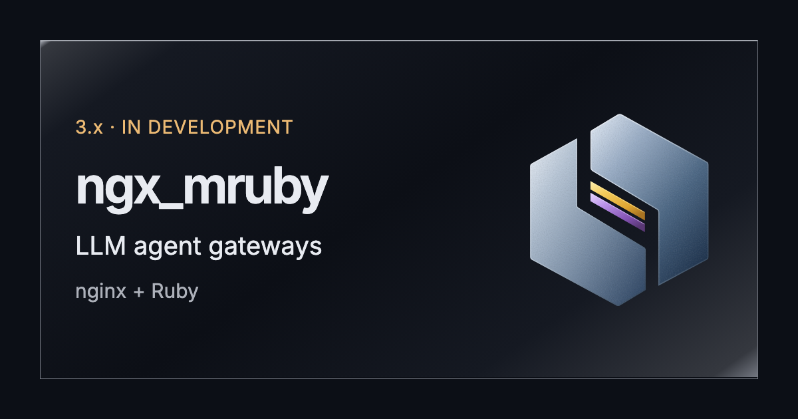
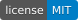

<p align="center">
  
</p>

<p align="center">
  <strong>ngx_mruby</strong>: A Fast and Memory-Efficient Nginx Extension Mechanism Scripting with mruby.
</p>

<p align="center">
  <a href="https://github.com/matsumotory/ngx_mruby/actions/workflows/test.yml?query=branch%3Anext"></a>
  <a href="https://github.com/matsumotory/ngx_mruby/actions/workflows/nginx-tests.yml?query=branch%3Anext"></a>
  <a href="https://github.com/matsumotory/ngx_mruby/actions/workflows/valgrind-nightly.yml?query=branch%3Amaster"></a>
  <a href="https://github.com/matsumotory/ngx_mruby/actions/workflows/codeql.yml?query=branch%3Anext"></a>
  <a href="https://github.com/matsumotory/ngx_mruby/actions/workflows/zizmor.yml?query=branch%3Anext"></a>
  <a href="https://www.bestpractices.dev/projects/16057"></a>
  <a href="https://scorecard.dev/viewer/?uri=github.com/matsumotory/ngx_mruby"></a>
  <a href="LICENSE"></a>
</p>

<p align="center">
  <a href="#backers" title="Backers on Open Collective"></a>
  <a href="#sponsors" title="Sponsors on Open Collective"></a>
</p>

## What it is

ngx_mruby lets you write the decisions of an nginx server in Ruby. You reference a Ruby script from nginx.conf, and nginx runs it with an embedded mruby VM at the point you choose: when a request arrives, to compute a variable, before access is granted, to produce the response, to change headers and body, during the TLS handshake, or for a TCP or UDP session. nginx keeps doing the network I/O, and no application server runs beside it. ngx_mruby builds as a static or dynamic module of unmodified nginx.

## Documents

- [Get started](examples/start/README.md): run nginx with a Ruby handler in Docker, then change the script
- [Install](docs/install/README.md), [guides](docs/README.md#documents) and [use cases](docs/use_case/README.md)
- [Directives](docs/directives/README.md), [Ruby classes and methods](docs/class_and_method/README.md) and [Build](docs/reference/build.md)
- [Concepts](docs/concepts/README.md): request phases, filters, waiting without blocking, and what a worker keeps between requests
- [Release notes](docs/releases/README.md): read "Behavior changes: read before upgrading" before you upgrade
- [Security policy](SECURITY.md) and [trust boundary](docs/security/trust-boundary.md)
- [Contributing](CONTRIBUTING.md)

[docs/README.md](docs/README.md) lists the pages by their kind.

## Branch strategy

ngx_mruby has three long-lived code branches: `master`, `next` and `v2.x`. Their names and roles stay as they are. `master` is the 2.x line until v3 is promoted to it, so that everyone who builds from the default branch keeps receiving the 2.x security fixes. v3 is developed on `next` and becomes `master` at v3.0.0 (the promotion). From then on, `v2.x` carries 2.x. The site, [ngx.mruby.org](https://ngx.mruby.org/), is built from `docs/` by `.github/workflows/site.yml` on `next` and deployed by GitHub Actions: 3.x from `next` at the unprefixed paths, 2.x from `master` under `/v2/`. The `gh-pages` branch keeps the old site as history.

```text
              until the promotion                 |  after the promotion
                                                  |
next    ---*alpha.1---*beta.1---*rc.1---*rc.N---+ |  - - ?
                                                 \
master  -*v2.7.0--*v2.7.x-- ... -----------o------M------*------*--- ... --> 3.x
         :        :                        :
v2.x    -*v2.7.0--*v2.7.x-- ... -----------o----------*------*------ ... --] 2.x

*  a release tag (v2.*, v3.*) or a pre-release tag (v3.0.0-*); v2.7.x stands
   for the 2.x releases after v2.7.0
o  the last 2.x commit on master
:  the same commit on both branches
M  the merge of next into master, tagged v3.0.0
?  what next becomes after the promotion is open (see the table below)
]  the end of 2.x support, twelve months after v3.0.0
The merges of master into next before the promotion are not drawn.
```

| Branch | Until the promotion | After the promotion (v3.0.0) |
|---|---|---|
| `master` (default branch) | The 2.x line: 2.x fixes, `v2.*` releases | The 3.x line: `v3.*` releases |
| `v2.x` | The same commits as `master`: a workflow copies every push to `master` to `v2.x` | The 2.x line: stability and security fixes, `v2.*` releases |
| `next` | Development of v3 and its pre-releases | Open; the recommendation is to keep it for the development of 3.1 (see [Promoting v3 to master](docs/DEVELOPMENT.md#promoting-v3-to-master)) |

Until the promotion, `master` is merged into `next` after 2.x fixes, so v3 has them too.

v3 is developed on `next`. Its pre-releases are tagged `v3.0.0-alpha.N`, `v3.0.0-beta.N` and `v3.0.0-rc.N` and are marked as pre-releases on GitHub. Section 6 of the v3 plan ([docs/proposals/v3-plan.md](https://github.com/matsumotory/ngx_mruby/blob/next/docs/proposals/v3-plan.md) on `next`) sets when the first pre-release of each kind is tagged:

- `v3.0.0-alpha.1`: when the 2.x test suite passes on the new core of v3 and the sanitizers report nothing.
- `v3.0.0-beta.1`: when the migration guide and the examples exist.
- `v3.0.0-rc.1`: when the site and the examples are complete.

`v3.0.0` is tagged when `next` is promoted to `master`, under the conditions in [Promoting v3 to master](docs/DEVELOPMENT.md#promoting-v3-to-master). No date is set. At least one `v3.0.0-rc.N` comes first, and how long the last one stays out before v3.0.0 is still open. The pre-releases and releases appear on the [releases page](https://github.com/matsumotory/ngx_mruby/releases); to be notified of them, watch the repository with "Custom" and "Releases" selected.

### For existing users

If you do not want anything to change, build from `v2.x` or from the latest `v2.*` release tag instead of `master`, and switch now:

```sh
git clone -b v2.x https://github.com/matsumotory/ngx_mruby.git     # the 2.x branch
git clone -b vX.Y.Z https://github.com/matsumotory/ngx_mruby.git   # or the latest v2.* release tag
```

A release tag does not receive fixes. If you pin one, move to each new 2.x release, because only the latest 2.x release is supported (see [SECURITY.md](SECURITY.md#supported-versions)), or pin `v2.x`, which receives the 2.x fixes as they are merged.

If you start using ngx_mruby now, the same applies: for production, build from `v2.x` or the latest `v2.*` release tag, and to try v3, track `next`.

Until the promotion, `v2.x` has the same commits as `master`, so pinning it does not change the code you build until then. At the promotion, `master` becomes v3.0.0, a new major version. Section 7 of the [v3 plan](https://github.com/matsumotory/ngx_mruby/blob/next/docs/proposals/v3-plan.md) already decides changes to its build requirements and behavior: mruby 4.1 instead of 3.3; nginx 1.30 (stable) and 1.31 (mainline) as the oldest supported versions, raised every April, so that users of older nginx (1.28, or the 1.26 and 1.24 packages of Linux distributions) stay on 2.x; OpenSSL 3.5 as the baseline with 1.1.1 and 3.0 dropped; the bundled `auto-ssl` mrbgem removed; and the behavior changes of item 8: a Ruby API called outside the phase it is designed for raises an exception, an exception after `rputs` returns 500, `Headers#delete` matches the full header name, `Nginx.return 200` with an empty body is allowed, and a body is sent with any status. The [v3 migration guide](https://github.com/matsumotory/ngx_mruby/blob/next/docs/migration/README.md) on `next` lists each of these changes once it is merged there.

The 2.x line (`master` until the promotion, then `v2.x`) puts compatibility first. It receives only stability fixes (crashes, hangs, leaks, and build fixes such as those for new nginx, OS, compiler or OpenSSL releases) and security fixes, and it changes behavior only as far as the fix of a defect requires. Since 2.7.1, the release notes in [docs/releases/](docs/releases/) list each such change. 2.x stays supported for twelve months after v3.0.0 (see [SECURITY.md](SECURITY.md#supported-versions)).

Releases are tagged `vX.Y.Z`. If you contribute a fix, send 2.x fixes to `master` until the promotion and v3 work to `next` (see [AGENTS.md](AGENTS.md#branches-and-pull-requests)).

Before upgrading, read the "Behavior changes: read before upgrading" section of every newer release in [docs/releases/](docs/releases/).

Please report security vulnerabilities privately as described in [SECURITY.md](SECURITY.md).

The project has earned the passing level of the [OpenSSF Best Practices badge](https://www.bestpractices.dev/projects/16057).

# Contributions

This project exists thanks to all the people who contribute. We also welcome financial contributions in full transparency on our [open collective](https://opencollective.com/ngx_mruby).

## Backers

Thank you to all our backers! [[Become a backer](https://opencollective.com/ngx_mruby#backer)]

<a href="https://opencollective.com/ngx_mruby#backers" target="_blank"></a>


## Sponsors

Support this project by becoming a sponsor. Your logo will show up here with a link to your website. [[Become a sponsor](https://opencollective.com/ngx_mruby#sponsor)]

# License

This project is under the MIT License:

* http://www.opensource.org/licenses/mit-license.php

The license text and the copyright notice are in [LICENSE](LICENSE) (the
same text as [MITL](MITL), which [LEGAL](LEGAL) and the sources refer to).
